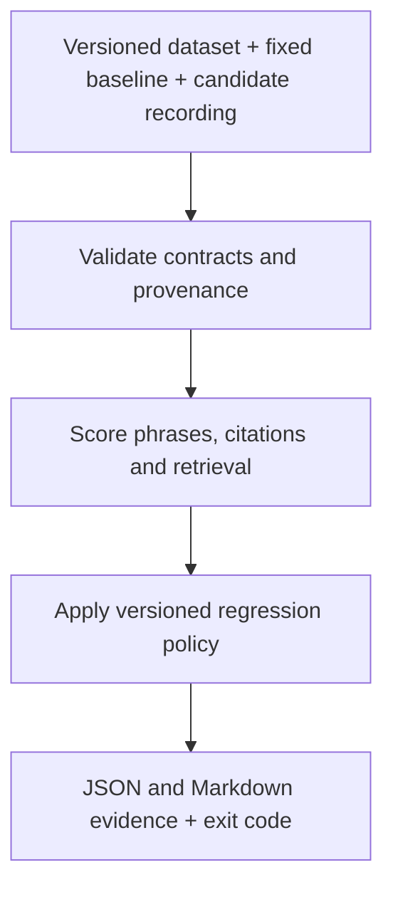

# LLM Regression Gate

**Catch measurable RAG regressions before accepting a pipeline change.**

[](https://github.com/Spoorthy-Siddannaiah/llm-regression-gate/actions/workflows/regression.yml)

## The problem

A RAG application can still run successfully after a prompt or retrieval change
while giving worse answers. Application tests can pass even when the model loses
the passage needed to answer a question.

I built a **Python evaluation CLI** that compares saved candidate responses with a
fixed baseline on the same versioned dataset. It measures phrase coverage,
citation labels and retrieval, applies an explicit policy, and writes case-level
evidence. Optional BM25 + Ollama generation creates new local recordings.

**Current CI replays recorded outputs. It does not generate fresh model answers
for every PR, prove semantic correctness, or deploy an application.**

[Experiment](#actual-experiment-and-results) · [Demo](#reproduce-the-terminal-demo) ·
[Architecture](#architecture) · [Limits](#limitations) · [Next steps](#next-improvements)

## Actual experiment and results

**Data:** 25 SQuAD 1.1 questions and 50 Wikipedia passages. **Model:** local
Llama 3.2, 3.2B Q4_K_M, with its digest and generation settings recorded.
These are actual model outputs; separate fictional support-policy fixtures test
predictable pass/fail behavior.

**Change:** reduce retrieved passages from three to one, keeping the model and
prompt unchanged. Both recordings use the same evaluator at K=3.

| Metric | Fixed baseline: top 3 | Candidate: top 1 | Change |
| --- | ---: | ---: | ---: |
| Required-phrase coverage | 84% | 68% | −16 percentage points |
| Citation-label coverage | 80% | 68% | −12 percentage points |
| Retrieval Recall@3 | 84% | 68% | −16 percentage points |

For “Who was the Super Bowl 50 MVP?”, the baseline answers **“Von Miller”**;
the candidate loses the associated passage and returns an empty answer.
The gate rejects the candidate with **exit 1** and explains the three metric drops.
This demonstrates lost evidence coverage, not worse BM25 ranking.

**Controlled fix:** a separate candidate restricts citation choices to retrieved
source IDs. Unknown citation occurrences fall **1 → 0**, with coverage/recall
unchanged at **84% / 80% / 84%**. It passes the unchanged v2 policy with **exit 0**.
The baseline and thresholds were not replaced. These are single-run observations,
not a statistical improvement claim or clinical validation.

Inspect the [regression report excerpt](docs/example-regression.md),
[raw retrieval experiment](recordings/squad/llama3.2-bm25-top1-v1/README.md),
[citation fix](recordings/squad/llama3.2-bm25-citation-enum-v2/README.md), and
[dataset attribution](datasets/squad/v1/README.md).

## Reproduce the terminal demo

Use Python **3.12.13** and uv **0.13.7** for the verified setup
([uv installation](https://docs.astral.sh/uv/getting-started/installation/)):

```sh
git clone https://github.com/Spoorthy-Siddannaiah/llm-regression-gate.git
cd llm-regression-gate
uv sync --python 3.12.13 --locked
uv run --locked python scripts/demo.py
```

Initial installation may download Python/packages. After that, the demo needs
**no model server, model download, API key or paid service**. It verifies all eight
saved scenarios, prints the measured regression and fix, and gives the location
of eight JSON and eight Markdown reports. Each default run uses a new temporary
location; `--output-dir reports/my-demo` selects a new directory explicitly.

The verified experiment values printed by the demo include:

```text
Required-phrase coverage: 84.0% -> 68.0% (-16.0 percentage points)
Citation-label coverage: 80.0% -> 68.0% (-12.0 percentage points)
Retrieval Recall@3: 84.0% -> 68.0% (-16.0 percentage points)
Unknown citation occurrences: 1 -> 0
```

**Demo exit 0 means all expected outcomes were verified, including rejection of
known bad candidates.** The evaluation CLI itself uses 0 = pass, 1 = quality
failure, 2 = input/execution error. See the [direct CLI walkthrough](docs/demo.md)
for individual commands and report inspection.

## Architecture



Reference labels stay separate from generation inputs. Both recordings receive the
same checks. Missing cases, duplicate IDs and incompatible comparisons are errors;
empty answers and unknown citations remain observations for scoring. A candidate
never automatically replaces the baseline.

See [module boundaries and generation flow](docs/architecture.md) and
[metric formulas, policies and provenance contracts](docs/technical-reference.md).

## Verification and CI

- **359 tests pass locally**, including three new demo tests; the isolated source snapshot also passed all 359.
- [Verified hosted run on `fd89a8c`](https://github.com/Spoorthy-Siddannaiah/llm-regression-gate/actions/runs/42788109117): tests, all eight replay checks and report upload passed.
- Replay verification checks expected exits **and failure reasons**, report evidence and all **54 fixed-baseline file hashes**.
- Expected rejection is a successful test only when the gate returns exit 1 for the intended reason; exit 2 fails verification.

```sh
uv run --locked pytest -q
uv run --locked python scripts/verify_replays.py --output-dir reports/review-new
uv build --python 3.12.13 --out-dir /tmp/llm-review-dist-new
```

The badge reports the published workflow. Local edits are not covered by that
hosted result. [Reproducibility instructions](docs/reproducibility.md) cover fresh
environments, wheel installation and the exact package names. The wheel contains
the evaluator; demos use the datasets and recordings in a source checkout.

## Limitations

- **Narrow checks:** literal phrases can accept negation and reject valid paraphrases or unit conversions. Valid citation IDs do not prove claim support. These are not official SQuAD EM/F1 scores or guaranteed hallucination detection.
- **Small evidence base:** the 25-question slice is nonrandom, source labels are incomplete, all real cases are standard, and model training-data contamination was not assessed. The baseline has known failures and is an observed reference, not an approved model.
- **Policy scope:** zero absolute floors can let unchanged poor quality pass. Aggregate gains can mask individual losses unless the optional case-count constraint is selected. Bundled thresholds are illustrative, not calibrated production requirements.
- **Operational scope:** no fresh inference per PR, deployment, production observability, clinical evaluation or healthcare compliance. No patient records or voize data are used.
- **Integrity scope:** hashes detect byte changes, not trusted execution. Raw recording evidence is not automatically redacted; report writes are non-atomic and may leave partial output.

The [complete limitations and security guidance](docs/technical-reference.md#known-limitations)
retain additional details on scaling, privacy, concurrency and provenance.

## Next improvements

1. Bind fresh candidate generation to the intended PR revision before gating it.
2. Expand reviewed cases for abstention, paraphrases and contradictions; measure false alarms and missed failures.
3. Calibrate semantic and claim-support evaluation against human labels.
4. Add a separately licensed, privacy-reviewed clinical-documentation benchmark; ACI-Bench remains a proposal, not current evidence.
5. Repeat experiments and measure latency/cost alongside quality.

These are planned extensions, **not implemented capabilities**.

## License

No license is currently provided for original project code or otherwise unlicensed
original material. Public visibility does not grant permission to reuse, modify or
redistribute that material. This does not override third-party licenses: the SQuAD
adaptation retains **CC BY-SA 4.0**, attribution and modification notices in its
[dataset README](datasets/squad/v1/README.md). No repository LICENSE file is included.
