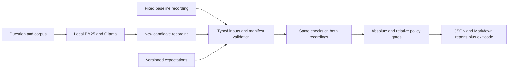

# LLM Regression Gate

Catch regressions in recorded RAG answers before a change ships. Compare a fixed
baseline with a candidate on a versioned dataset, inspect JSON/Markdown evidence,
and return a distinct exit code for quality failures versus execution errors.

Python 3.12+ · Pydantic · pytest · local Ollama optional · no paid APIs

**v0.1.0 scope:** a working regression-evaluation component of the LLM Reliability
Platform. Live observability, deployment, and a clinical-documentation benchmark
are future work. This project is separate from the Databricks Enterprise AI
Knowledge Copilot.

## Try it in five minutes

Install [uv](https://docs.astral.sh/uv/getting-started/installation/), clone this
repository, and run from its root. Dependency installation needs internet; replay
needs no model, API key, or Ollama server.

```sh
uv sync --python 3.12 --locked
uv run --python 3.12 --locked pytest
```

Compare two **actual local model recordings**. The candidate intentionally reduces
the passage budget from three to one:

```sh
DEMO_OUTPUT="$(mktemp -d /tmp/llm-regression-demo.XXXXXX)/comparison"
uv run --python 3.12 --locked llm-reliability \
  --dataset datasets/squad/v1/dataset.json \
  --sources datasets/squad/v1/sources.json --require-manifests \
  --baseline recordings/squad/llama3.2-bm25-v1/recording.json \
  --candidate recordings/squad/llama3.2-bm25-top1-v1/recording.json \
  --policy configs/gate.relative-only.v1.json \
  --settings configs/evaluator.v1.json \
  --output-dir "$DEMO_OUTPUT"
# Expected: FAIL, exit 1, with three excessive_drop failures.
# Open "$DEMO_OUTPUT/report.md" to inspect the evidence.
```

Exit 1 is intentional in this demo. In CI, an expected-rejection test checks that
exit and its evidence; an actual release gate must block on it. For pass, regression,
absolute-quality failure, and invalid-input examples, see the [demo runbook](docs/demo.md).
Output directories must be new; existing reports are never overwritten.

## What the real experiment caught

The integration dataset is a pinned **25-question, 50-passage SQuAD slice**.
Both recordings use the same local Llama 3.2 model digest, prompt, and BM25 settings;
the intended change is the retrieval passage budget.

| Metric | Fixed baseline: top 3 | Candidate: top 1 | Change |
| --- | ---: | ---: | ---: |
| Required-phrase coverage | 84% | 68% | −16 percentage points |
| Citation-label coverage | 80% | 68% | −12 percentage points |
| Retrieval Recall@3 | 84% | 68% | −16 percentage points |

For “Who was the Super Bowl 50 MVP?”, the baseline answers “Von Miller”; the
candidate loses the associated passage and returns an empty answer. The CLI
rejects the candidate while preserving the baseline. See the
[recordings](recordings/README.md) and [measured evidence](benchmarks/README.md).
This small single-run experiment does not establish generalization or causality
for every answer difference.

## Controlled fix, checked against the same baseline

A follow-up request-schema change constrained citations to retrieved IDs. In the
[actual candidate run](recordings/squad/llama3.2-bm25-citation-enum-v2/README.md),
unknown citation occurrences fell **1 → 0** while all three aggregate metrics
stayed unchanged. The unchanged v2 policy passed with **exit 0**. Raw requests,
responses, hashes, and the captured code target are included for offline replay.
This is evidence for one controlled run, not proof of universal correctness.

## Flow



Generation is explicitly invoked and separate from offline evaluation. Reference
answers and relevance labels never enter the generation prompt. A local
[generate-and-compare command](docs/local-candidate-workflow.md) captures a code
target, records a candidate, verifies freshness, and compares it with the reference.
The installed model must match the pinned digest; nothing is downloaded automatically.

## Implemented checks

- Strict typed inputs: stable IDs, unique cases, exact case coverage, compatible
  dataset versions, and actionable file-aware errors.
- Required phrases, citation-label coverage, retrieval Recall@K, and critical-case
  guards. Versioned policies combine absolute floors with allowed drops.
- Paired case changes expose regressions hidden by aggregate gains. Optional
  `max_regressed_cases` strengthens a policy; omitted means no added constraint.
- Duplicate JSON keys and missing labelled corpus references are rejected. CLI
  provenance receipts identify inputs and evaluator sources by SHA-256.
- Corpus membership for citation IDs: v2 can enforce absolute unknown-ID limits
  and allowed increases. Optional answer-alternative diagnostics stay separate.
- Dataset/corpus/artifact hashes, model/configuration identity, and optional
  expected-code checks. Malformed or incompatible inputs stop before scoring.
- Non-overwriting JSON/Markdown reports. The baseline is never automatically promoted.

| Exit | Meaning |
| --- | --- |
| 0 | Evaluation completed and the selected gate passed |
| 1 | Evaluation completed and the selected gate failed |
| 2 | Invalid inputs or execution failure; no trustworthy quality decision |

## CI and release boundaries

[GitHub Actions](.github/workflows/regression.yml) runs tests and eight offline
replays on PRs, pushes, and manual dispatch. Known passing cases must pass; known
bad cases must be rejected for the expected reason. Reports are uploaded when
available. No model calls or provider secrets are needed in CI.

A green replay workflow verifies the evaluator against saved recordings. It does
not generate fresh answers from a PR's changed pipeline or deploy anything.
Hosted execution and branch protection require verification after publication.

Phrase matching does not understand negation or paraphrases. A valid citation ID
does not prove that a passage supports an answer. Associated-source labels can be
incomplete. Hashes are integrity checks, not signed execution attestation. The
observed real baseline has known defects and is not release-approved.

## Explore the project

| Location | Purpose |
| --- | --- |
| `src/llm_reliability/` | Models, loading, scoring, gates, reports, local generation |
| `datasets/` | Versioned expectations and source corpora |
| `recordings/` | Handwritten fixtures and actual local model evidence, labelled separately |
| `configs/` | Evaluator settings and versioned gate policies |
| `scripts/` | Dataset preparation, retrieval measurement, local recording/orchestration |
| `tests/` | Offline unit, integration, and regression tests |
| `benchmarks/` | Measured experiments and reproduction instructions |

Read the [architecture](docs/architecture.md), [provenance contract](docs/provenance.md),
[local generation configuration](docs/local-generation.md), and
[interview questions](docs/interview-questions.md).
The [voize dataset plan](docs/voize-dataset-plan.md) recommends ACI-Bench for a
future simulated clinical-documentation benchmark; it has not been imported.

## Data attribution

The SQuAD adaptation is distributed under CC BY-SA 4.0; see its
[attribution and modifications](datasets/squad/v1/README.md). Dataset and recording
origin notices are separate from any license for the project's original code.
The original code is currently unlicensed; no open-source reuse license is granted.

## Methodology and report example

Required-fact phrases use AND semantics; alternative phrases are a separate optional
OR diagnostic. Citation-label coverage is labelled-source recall, not precision
or claim support. Cases are weighted equally, with inclusive thresholds and a
1e-12 numeric tolerance. The default zero floors cannot establish absolute quality.
All real SQuAD cases are standard, not clinically reviewed critical cases.

Current output is **report schema 4**. See the [actual regression report excerpt](docs/example-regression.md)
and [audit-fix verification](docs/audit-fixes.md) for commands and schema migration.
Old versioned evidence remains untouched. No general semantic correctness,
guaranteed hallucination detection, healthcare certification, full production
deployment, live trace monitoring, or fresh inference for every PR is claimed.

The PEP 517 build stack is pinned in `pyproject.toml`; runtime/test packages remain
in `uv.lock`. Build locally with `uv build --python 3.12 --out-dir /tmp/llm-dist-new`.
CI selects Ubuntu 24.04 (whose image still receives updates), pinned action SHAs,
Python 3.12.13 and uv 0.7.12. Hosted behavior remains unverified.
