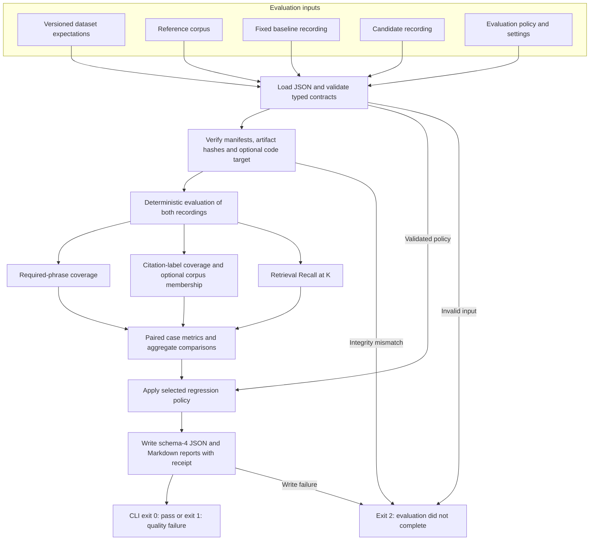

# LLM Regression Gate

**Catch measurable RAG regressions before accepting a pipeline change.**

[](https://github.com/Spoorthy-Siddannaiah/llm-regression-gate/actions/workflows/regression.yml)

**The problem:** a RAG application can still run successfully after a prompt or
retrieval change while giving worse answers. A passing application test does not
tell you whether the model lost the evidence needed to answer a question.

**What I built:** a Python CLI that compares candidate responses with a fixed
baseline on a versioned dataset. It checks required phrases, citations and
retrieval results, explains which cases got worse, and returns a pass/fail exit
code that CI can enforce. Optional local BM25 + Ollama generation creates new
recordings; everyday evaluation replays saved outputs without paid APIs.

**The proof:** on 25 public SQuAD questions over 50 Wikipedia passages, reducing
retrieval from three passages to one caused measured coverage drops in actual
Llama 3.2 outputs, and the gate rejected the candidate.
A separate citation-schema fix passed the unchanged policy. Neither experiment
replaced the baseline or weakened the thresholds.

**The boundary:** this is a reproducible evaluation and release-checking project,
not proof of semantic correctness or a clinically validated system. Current CI
tests recorded examples; it does not generate fresh model answers for every PR.

[See the evidence](#example-regression-and-controlled-fix) ·
[Run it locally](#getting-started) · [How it works](#architecture) ·
[Limitations](#known-limitations) · [Next improvements](#future-improvements)

## What I built

- **Evaluation CLI:** one comparison command, JSON/Markdown reports, and distinct exits for pass, quality failure and execution error.
- **Local RAG example:** BM25 retrieval over public Wikipedia passages and actual Ollama/Llama 3.2 recordings.
- **Regression policies:** shared checks for baseline and candidate, aggregate and case-level changes, critical cases and optional unknown-citation limits.
- **Reproducible evidence:** separate reference data and model recordings, versioned settings, raw request/response evidence and hash-based provenance checks.
- **GitHub Actions:** 356 tests and eight replay scenarios that verify both expected acceptance and expected rejection, with downloadable reports.

```text
Versioned dataset + fixed baseline + candidate recording
                         ↓
             Validate inputs and provenance
                         ↓
          Score both → compare → apply policy
                         ↓
              JSON + Markdown evidence
                         ↓
       Exit 0: pass · 1: quality failure · 2: error
```

## Example regression and controlled fix

A developer reducing the retrieval passage budget can remove evidence the model
needs. The saved top-one candidate demonstrates this with actual model outputs:

| Metric | Fixed baseline: top 3 | Candidate: top 1 | Delta |
| --- | ---: | ---: | ---: |
| Required-phrase coverage | 84% | 68% | −16 percentage points |
| Labelled citation coverage | 80% | 68% | −12 percentage points |
| Retrieval Recall@3 | 84% | 68% | −16 percentage points |

For “Who was the Super Bowl 50 MVP?”, the baseline answers “Von Miller”; the candidate
loses the associated paragraph and returns an empty answer. After validating both
recordings, the engine computes that case's phrase, citation and retrieval drops.
The relative-only policy rejects all three aggregate drops, writes per-case
explanations and returns **exit 1**. See the [actual report excerpt](docs/example-regression.md).

An invalid-citation failure is demonstrated separately. The observed baseline
contains one cited ID with an extra character, absent from the corpus. Its v2
self-check has zero relative degradation but fails the absolute zero-unknown limit.
This distinguishes an existing quality defect from a newly introduced regression.
A future candidate introducing an unknown ID would be checked by the same v2 rules;
an unsupported claim without a failing assertion may remain undetected.

The controlled fix restricts generated citation choices to the exact retrieved IDs.
Its recorded candidate has **0 unknown citation occurrences versus 1 in the baseline**,
with coverage/recall unchanged at **0.84 / 0.80 / 0.84**. The unchanged v2 policy
returns **exit 0**. Only the affected case's citation observations differ; the
baseline and thresholds were not replaced. These are small, single-run experiments,
not statistical evidence of generalization, latency reduction or clinical safety.

## Getting started

From a local checkout, with uv and Python 3.12.13 available:

```sh
uv sync --python 3.12.13 --locked
uv run --locked python scripts/verify_replays.py --output-dir reports/first-review
```

Choose a new output directory each time. This runs eight saved scenarios, including
intentional failures, and writes JSON/Markdown reports. The verification command
exits 0 only when **every scenario produces its expected decision**; individual
bad candidates are expected to fail their gates.

After dependency installation, replay needs **no model server, API key or paid
service**. For installation details, a direct comparison command and exit codes,
see [detailed local usage](#detailed-local-usage).

## Verification and test results

**Verified locally and on GitHub Actions using Python 3.12.13.**
The [successful hosted run](https://github.com/Spoorthy-Siddannaiah/llm-regression-gate/actions/runs/42700771347)
evaluated commit `995ef72`: all 356 tests and eight replay checks passed.
Its eight JSON and eight Markdown reports were downloaded and checked.

| Verification | Result |
| --- | --- |
| Full test suite | 356 passed |
| CI replay scenarios | 8 expected outcomes |
| Hosted GitHub Actions | 356 tests and all 8 replay checks passed on `995ef72` |
| Isolated source snapshot with fresh locked installation | 356 passed |
| Wheel and source distribution | Successfully built |
| Installed wheel replay outside the source checkout | Passed |
| Baseline integrity | 54/54 files unchanged |

Tests cover schema/coverage errors, known gate outcomes, case-level masking, input
drift, sanitized provider failures with fictional markers, duplicate JSON keys,
report/receipt consistency and recording integrity. Model calls are mocked where
needed. The isolated-snapshot and installed-wheel checks are documented in
[audit-fix verification](docs/audit-fixes.md); the snapshot checks the copied source
and existing Git history rather than manufacturing a new commit.

[GitHub Actions](.github/workflows/regression.yml) is configured for pull requests,
pushes and manual dispatch, with read-only contents permissions, nonpersisted
checkout credentials and pinned action SHAs. Available evaluation reports are
configured for upload with seven-day retention. Known rejected candidates must
produce the expected evaluation exits; the v2 replay steps also inspect reasons.
A green workflow validates the evaluator against saved examples, not fresh model
outputs from that PR and not deployment eligibility.

The badge links to the workflow's current status; the run linked above is the
specific verified result. Hosted success validates the saved scenarios, not fresh
inference, production quality or deployment eligibility. Credential-pattern scanning
is a limited check, not a comprehensive security guarantee.

## Known limitations

- Literal phrase checks can accept negation or unsupported additions and reject valid paraphrases or unit conversions.
- Citation-label coverage does not prove claim support; unlabelled IDs can be legitimate, and corpus membership establishes only existence in that snapshot.
- The selected SQuAD slice is small and nonrandom; relevance labels are not exhaustive, and no explicit correct-abstention or clinical safety benchmark exists.
- No training-data contamination assessment or held-out production benchmark is provided.
- Zero metric floors cannot establish absolute quality, and aggregate improvements can offset standard-case losses unless a stricter case constraint is selected.
- No general semantic correctness, factual completeness or guaranteed hallucination detection is provided; no LLM judge is implemented.
- No fresh model inference is automatically performed on each PR, and baseline/policy changes are not protected by repository rules implemented in this code.
- In-memory retrieval and whole-file processing are intended for small local evaluations; large-scale throughput, latency and cost are not benchmarked.
- Report writes can leave partial artifacts on I/O failure, and generation does not implement resumable distributed execution.
- This is not a live production observability platform or deployment system; sensitive production use requires additional privacy and operational controls.

## Future improvements

The next priorities address the current project's largest gaps. These are
**planned improvements, not implemented capabilities**:

| Priority | Improvement | Evidence it should add |
| --- | --- | --- |
| 1 | Generate a fresh candidate from the intended PR revision, then run the existing gate | Detect behavior changes in the proposed pipeline rather than only replay known recordings |
| 2 | Expand the dataset with reviewed answerable, unanswerable, paraphrase and contradiction cases | Measure false alarms and missed failures in the current checks |
| 3 | Add semantic and claim-support evaluation, calibrated against human labels | Assess meaning and citation support beyond phrase presence and source-ID membership |
| 4 | Add a separately scoped clinical-documentation benchmark with licensing and privacy review | Test domain-relevant errors without presenting SQuAD results as clinical evidence |
| 5 | Repeat controlled runs and measure latency/cost alongside quality | Evaluate variability and trade-offs beyond one saved run per configuration |

These are separate engineering tasks, not prerequisites to reproducing this release's
recorded-response examples. ACI-Bench remains a proposal, not current evidence.

## Architecture



The corpus is required for real recording manifests and v2 membership enforcement;
synthetic v1 comparisons can operate without one. Membership can also be requested
as a report-only diagnostic. Optional local generation produces a new candidate
before this evaluation flow; it never promotes the candidate to baseline.
See [module boundaries and provenance contracts](docs/architecture.md).

## Technical reference

<details>
<summary>Evaluation contracts, data origins, implementation details and operating guidance</summary>

## Problem and motivation

LLM generation can vary across runs, model runtimes and hardware, even with fixed
sampling settings. A change to context selection or output formatting may improve
one case while breaking another. Aggregate scores can hide those exchanges.

A useful regression decision therefore needs stable cases, separate recordings,
explicit expectations and inspectable provenance. Replaying fixed outputs makes
the evaluator repeatable; generating fresh outputs is a separate operation. A team
can use the resulting exit code to block a pipeline stage when a selected policy
fails, while reviewing the evidence rather than interpreting a score as proof of
correctness. This repository's CI exercises known recorded examples; it does not
automatically generate new answers from every pull request.

## Key capabilities

- **Versioned datasets:** stable case IDs bind questions to required phrases, relevant source IDs and criticality.
- **Separate recordings:** baseline and candidate files retain observed answers, citations, ranked retrieval IDs and configuration versions.
- **Strict input validation:** typed loaders reject malformed data, duplicate IDs or JSON keys, incompatible dataset versions, missing/extra cases and invalid labelled corpus references.
- **Required-phrase checks:** normalized literal matching records which authored assertions are present or missing.
- **Labelled citation coverage:** cited source IDs are compared with each case's relevance labels without treating every unlabelled citation as invalid.
- **Corpus membership:** exact cited-ID lookup distinguishes existing sources from unknown IDs in the supplied snapshot.
- **Retrieval Recall@K:** ranked retrieval is evaluated against relevant-source labels with one shared cutoff for both recordings.
- **Paired case changes:** reports identify improved, unchanged and regressed cases, affected metrics and critical-case regressions.
- **Configurable gates:** policies combine absolute metric floors, allowed drops, critical-fact requirements and an optional maximum regressed-case count.
- **Unknown-citation limits:** an explicitly selected v2 policy can enforce both an absolute count and a maximum increase from baseline.
- **Provenance checks:** recording manifests verify dataset, corpus and evidence hashes, with optional candidate-code target validation.
- **Evaluation receipts:** CLI reports identify input bytes, evaluator source files, policy/evaluator versions and target-validation outcome without embedding raw content in the receipt.
- **Offline reports and replay:** JSON/Markdown reports and explicit exit codes support regression testing without live inference or paid APIs.

## Execution lifecycle

1. **Identify inputs:** the CLI fingerprints relevant input files and evaluator package sources before evaluation.
2. **Load and validate:** loaders parse dataset/recordings, check exact case coverage and dataset identity/version, and validate labelled source references when a corpus is available.
3. **Verify provenance:** applicable manifests must describe completed full-dataset runs and match input/artifact hashes; an explicitly supplied candidate code target must match its recorded revision and source hashes.
4. **Select checks:** load policy/settings and optional diagnostics, then apply identical evaluator settings to baseline and candidate, joining responses by case ID.
5. **Compare evidence:** calculate case metrics and case-weighted means, compare candidate minus baseline, and evaluate the configured rules, including v2 membership limits when selected.
6. **Confirm stability:** recheck relevant input and evaluator hashes before reporting; detected drift prevents report writing.
7. **Write results:** render paired case changes, gate failures, configuration snapshots and a provenance receipt into a new directory, then return the decision code.

Initial input/provenance validation failures stop before scoring; later drift,
evaluator or I/O errors also return 2. Report writes are not atomic, so an I/O failure may leave partial output.
Existing report directories are refused rather than overwritten. Empty answers and
unknown observed citations remain valid inputs for scoring, rather than schema errors.

## Evaluation data and model evidence

### Public benchmark data — SQuAD 1.1

The integration dataset is a **fixed, reproducibly selected slice of 25 questions
and 50 Wikipedia passages**, covering Super Bowl 50, Warsaw, the Normans, Nikola
Tesla and computational complexity. It includes benchmark questions, human answer
spans and associated source paragraphs, plus distractor paragraphs.

Selection uses the first five articles and first ten paragraphs per article;
the first question in each of paragraphs 0–4 becomes an evaluation case. The first
annotated answer supplies the required phrase; other answers remain in a separate
reference file for an optional diagnostic. All 25 cases are labelled standard.
This is public benchmark data, not production traffic or a representative sample.

The importer verifies a pinned upstream revision and checksum. Attribution,
selection details, modifications and CC BY-SA 4.0 terms are in the
[dataset README](datasets/squad/v1/README.md).

### Actual model-generated responses — Ollama / Llama 3.2

Three committed recordings contain actual locally generated responses. All use
the **same model**, not a comparison between different model families:

- Saved model tag: `llama3.2:latest`, 3.2B parameters, Q4_K_M quantization.
- Pinned digest: `a80c4f17acd55265feec403c7aef86be0c25983ab279d83f3bcd3abbcb5b8b72`.
- Saved Ollama server version: 0.33.3; temperature 0, seed 42, context budget 4096 and output limit 256 tokens.
- Local retrieval: in-memory BM25 with versioned settings, k1 1.2 and b 0.75.

| Recording | Intended configuration difference | Evidence |
| --- | --- | --- |
| Observed baseline | Top 3 passages, `grounded-json-v1` | [Baseline recording](recordings/squad/llama3.2-bm25-v1/README.md) |
| Degraded candidate | Top 1 passage, same model and prompt | [Retrieval experiment](recordings/squad/llama3.2-bm25-top1-v1/README.md) |
| Citation-fix candidate | Top 3 passages, `grounded-json-v2-citation-enum` | [Controlled fix](recordings/squad/llama3.2-bm25-citation-enum-v2/README.md) |

Recordings are separate from reference questions, answers and passages. Generation
receives only the question and retrieved source IDs/text, not reference answers or
relevance labels. Requests, responses, configurations and manifests are retained
for inspection. Saved outputs allow offline replay without fresh inference on
every CI run; fixed temperature/seed do not guarantee generation determinism.

The baseline has known defects and is an observed reference, **not a release-approved
model**. The original baseline and top-one recordings predate code snapshots; the
citation-fix recording includes its original expected code target.

### Synthetic fixtures — fictional support policies

Handwritten refund rules and customer-support hours provide predictable passing,
failing and critical-regression scenarios. These are explicitly labelled test
fixtures, not outputs from real model calls. See [recording origins](recordings/README.md).

**No patient records or voize data are used.** ACI-Bench is a
[future dataset recommendation](docs/voize-dataset-plan.md); it has not been
imported or evaluated in this implementation.

## Evaluation methodology and limitations

> These deterministic checks provide reproducible evidence-based validation, but do not establish general semantic correctness, factual completeness or guaranteed hallucination detection.

| Check | Actual calculation | What it does not establish |
| --- | --- | --- |
| Required-phrase coverage | Matched required phrases / required phrases, per case | Truth, contradiction detection or paraphrase equivalence |
| Labelled citation coverage | Relevant cited IDs / labelled relevant IDs, per case | Citation precision or support for each answer claim |
| Corpus membership | Exact cited-ID membership; unknown occurrences counted across cases | Why an ID is unknown, or whether an existing passage is relevant |
| Retrieval Recall@K | Relevant IDs in the first K retrieved results / labelled relevant IDs | Semantic retrieval quality beyond the supplied labels |

Phrase matching case-folds and normalizes whitespace, retains literal punctuation,
and checks word boundaries. Required facts use **AND** semantics. Optional annotated
answer alternatives use **OR** semantics but remain report-only; they do not change
the gate. These scores are not official SQuAD exact-match/F1 scores.

Each aggregate metric is the equally weighted mean of case scores. Deltas are
candidate minus baseline; a drop of 0.02 means two percentage points. Minimum floors
and allowed drops are inclusive, with a 1e-12 comparison tolerance. The critical-fact
rule rejects a critical candidate missing any required phrase, even if its baseline
was already poor. Optional `max_regressed_cases` counts a case once if any of the
three coverage/recall metrics drops; gains do not cancel that loss within the case.
It is disabled when omitted. A mixed-change case is reported as regressed while
listing both improved and regressed metrics.

**Reference-based evaluation** compares authored phrase/source expectations with
observations. **Retrieval evaluation** checks ranked source recovery. **Citation
validation** separates relevance-label coverage from corpus existence. **Policy
evaluation** decides whether these measured changes are acceptable; it does not
add a semantic correctness judgment. An unknown-citation cap alone cannot reject
an unsupported claim whose source IDs and required phrases otherwise pass.

V1 policies cover metric floors/drops, critical facts and the optional case limit.
V2 adds `max_candidate_unknown` and `max_increase` counts. The default v1 policy has
zero floors and permits no aggregate drops: unchanged poor quality can pass.
An empty citation list has zero unknown IDs, not proof of citation quality; labelled
coverage separately exposes omitted sources. Thresholds need domain review and
calibration; the bundled policies illustrate
behavior, not production acceptance criteria. See [v2 policy semantics](docs/citation-gate-v2.md).

## Technology stack

| Area | Implemented technology |
| --- | --- |
| Language/runtime | Python 3.12+; verification environment and CI select 3.12.13 |
| Validation/schemas | Pydantic 2; locked version 2.14.3 and generated JSON schemas |
| Inference/recording | Optional loopback-only Ollama client, pinned Llama 3.2, standard-library HTTP/JSON |
| Evaluation/testing | Custom deterministic checks, local BM25 and pytest; locked pytest 9.2.0 |
| Build/dependencies | uv 0.13.7 in CI, `uv.lock`, Hatchling 1.27.0 and explicitly pinned build dependencies |
| CI integration | GitHub Actions on Ubuntu 24.04, immutable action SHA references and report artifact upload configuration |

No hosted LLM provider, vector database, application server or telemetry backend is
required. CI is validation/replay only; no delivery or deployment stage exists.
The selected runner image still receives updates and is not an immutable OS snapshot.

## Repository structure

```text
.github/workflows/regression.yml       Tests and eight offline CI replay checks
src/llm_reliability/
  models.py, loading.py                Typed inputs, compatibility and file validation
  runner.py, gates.py                  Shared evaluation and policy decisions
  fact_checks.py, source_checks.py     Required phrases, citation labels and recall
  citation_existence.py               Corpus membership evidence
  answer_alternatives.py              Separate annotated-answer phrase diagnostic
  alternative_diagnostics.py          Validated optional reference evidence
  provenance.py, run_provenance.py     Recording integrity and candidate code snapshots
  evaluation_receipt.py, reports.py    Hash receipts and JSON/Markdown rendering
  retrieval.py, generation.py          Explicit local BM25/Ollama pipeline
  cli.py                              Offline comparison command
  squad.py                            Pinned SQuAD importer
scripts/                              Preparation, recording and verification entry points
datasets/                             Versioned expectations, corpus, references and attribution
recordings/                           Separate synthetic fixtures and actual model evidence
configs/                              Evaluator settings and versioned policies
benchmarks/                           Measurements and historical experiment artifacts
tests/                                Offline unit, integration and regression tests
docs/                                 Architecture, demo, provenance and report examples
pyproject.toml, uv.lock                Package metadata, build pins and dependency lock
CHANGELOG.md                          Implemented release scope and audit hardening
```

## Detailed local usage

### Prerequisites and installation

Use a local checkout of this repository, **Python 3.12.13** for the verified workflow,
and uv. Install uv using its [official installation instructions](https://docs.astral.sh/uv/getting-started/installation/).
Git is required for provenance-aware verification; replay itself needs no model
installation. Run these commands from the repository root:

```sh
uv sync --python 3.12.13 --locked

uv run --locked pytest -q

uv run --locked python scripts/verify_replays.py \
  --output-dir reports/review-new

uv build --python 3.12.13 \
  --out-dir /tmp/review-dist-new
```

Locked installation and building may need internet to obtain Python/packages.
After dependencies are installed, tests and recorded-response evaluation run
offline: **no Ollama server, model download, provider key or paid API is required**.
Only the separate local recording/generate-and-compare scripts require an installed
matching Ollama model and a running local service; they never pull a model or start
that service automatically. See [local generation](docs/local-generation.md) and
[the opt-in wrapper](docs/local-candidate-workflow.md) before invoking inference.

`verify_replays.py` checks eight expected outcomes and all 54 baseline file hashes.
Its own exit 0 means each known example passed or was rejected as expected; it does
not mean every candidate passed. Reports appear under `reports/review-new/<scenario>/`
as `report.json` and `report.md`. Use a **new output directory** on each replay.
Build artifacts go to `/tmp`; generated reports are ignored by Git.

### Run one comparison directly

```sh
uv run --locked llm-reliability \
  --dataset datasets/squad/v1/dataset.json \
  --sources datasets/squad/v1/sources.json --require-manifests \
  --baseline recordings/squad/llama3.2-bm25-v1/recording.json \
  --candidate recordings/squad/llama3.2-bm25-top1-v1/recording.json \
  --policy configs/gate.relative-only.v1.json \
  --settings configs/evaluator.v1.json \
  --output-dir reports/example-regression-new
```

Expected: three `excessive_drop` failures and **exit 1**, deliberately demonstrating
rejection. In a shell using `set -e`, handle that expected status explicitly.
For passing, invalid-input, absolute-quality and controlled-fix commands, use the
[five-case demo](docs/demo.md).

| CLI exit | Meaning |
| --- | --- |
| 0 | Evaluation and reporting completed; selected gate passed |
| 1 | Evaluation and reporting completed; selected gate failed |
| 2 | Invalid input, integrity mismatch or execution/reporting failure |

## Engineering design decisions

- **Separate references from observations:** labelled answers must not leak into generation prompts or be mistaken for model baseline outputs.
- **Keep the baseline fixed:** a candidate is compared with an explicit reference, and any later promotion requires a deliberate review decision.
- **Bind provenance to bytes:** version labels alone miss silent edits, so manifests verify input/evidence hashes and the recorder processes captured input bytes.
- **Use narrow deterministic checks:** their failure conditions are inspectable and replayable, while their semantic blind spots remain explicit.
- **Expose paired changes:** a reviewer can see case regressions that disappear in means and choose a stricter case-count policy when justified.
- **Separate measurement from acceptance:** configurable thresholds express reviewed requirements rather than hardcoding one universal definition of quality.
- **Preserve failed-run evidence:** exclusive output creation and completion markers prevent silent overwrites or automatic acceptance of incomplete runs.
- **Keep evaluation offline:** CI can test scoring and policies quickly without inference availability, cost or generation variability; fresh candidate generation remains an explicit responsibility.

## Security and privacy

Loaders reject ambiguous/malformed evaluation inputs and validate source-label
relationships. Manifest artifact paths must stay inside the recording directory,
including after symlink resolution. CLI input/source fingerprints are checked
before and after evaluation. The recorder parses captured dataset/corpus bytes and
checks the original files again before marking a run complete.

Recorder failures emit fixed categories, stages and sanitized validation locations,
not raw provider exception messages or response bodies. Raw requests/responses are
still intentionally retained as evidence: **safe error output is not data redaction**.
Public examples use benchmark text and fictional policies, not patient records.
Sensitive production traces would require restricted storage, access controls,
minimization, retention/deletion rules and additional privacy review outside public Git.

Manifests and receipts provide integrity checks, not signatures, proof of trusted
execution or proof that a recording came from the current PR. Target matching only
checks the explicitly supplied snapshot. File rechecks are not transactions against
hostile concurrent writers. See [provenance](docs/provenance.md) and
[candidate freshness](docs/candidate-freshness.md). No GDPR compliance or healthcare
certification is claimed. Preserve the dataset attribution when sharing its adaptation.

</details>

## License

For the original project code and otherwise unlicensed original material:

> No license is currently provided. Public visibility of this repository does not grant permission to reuse, modify or redistribute its contents.

This does not override separately licensed third-party material. The adapted SQuAD
dataset retains **CC BY-SA 4.0**, its author attribution and modification notices;
see [dataset licensing and provenance](datasets/squad/v1/README.md).
No repository LICENSE file has been introduced.
