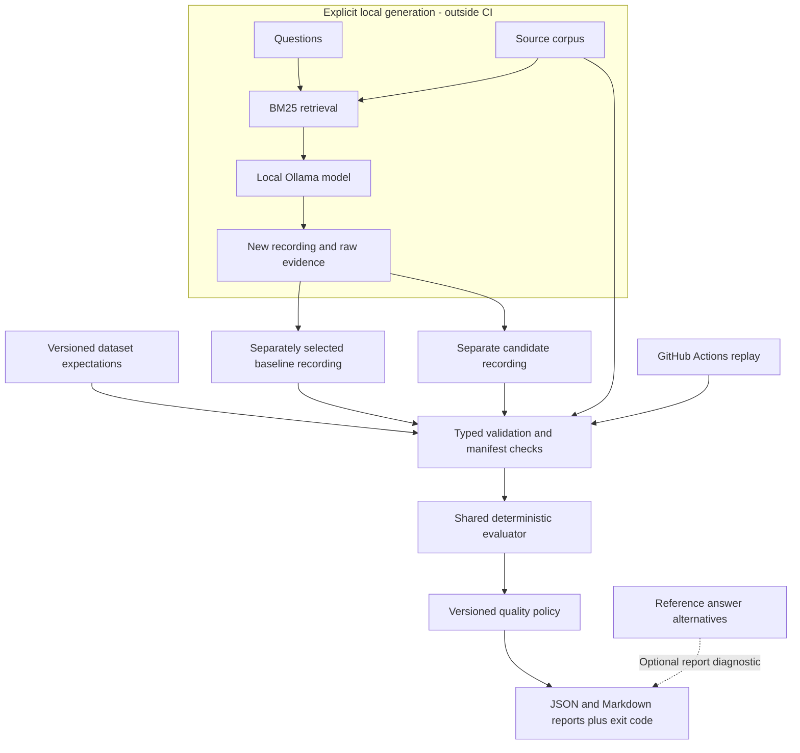

# Regression component architecture

This component compares saved outputs from two RAG configurations. It runs locally
without paid APIs and keeps the accepted reference fixed. The current real reference
is an observed run with known failures, not a release-approved baseline.

The baseline and candidate come from different runs. Selecting a reference is a
deliberate review decision; nothing automatically replaces it. Dataset labels and
reference answers enter evaluation only, never the generation prompt.

## Responsibilities

| Module | Responsibility |
| --- | --- |
| `models.py`, `loading.py` | Typed inputs, unique IDs, exact coverage, compatible dataset versions |
| `provenance.py` | Full-run manifests, configuration consistency, dataset/corpus/evidence hashes |
| `retrieval.py`, `generation.py` | Opt-in local pipeline; question and retrieved passages only |
| `runner.py`, `fact_checks.py`, `source_checks.py` | Apply the same evaluator settings to both recordings |
| `gates.py` | Compare metrics, apply absolute and relative limits, preserve failure evidence |
| `citation_existence.py`, `alternative_diagnostics.py` | Corpus membership and optional answer-variant evidence |
| `reports.py`, `cli.py` | Non-overwriting output and explicit process outcomes |

Required facts use AND semantics. Alternative answer phrases use OR semantics
and remain report-only. V1 gates compare case-weighted phrase coverage,
citation-label coverage, and Recall@K, with an independent critical-case guard.
V2 adds absolute unknown-citation counts and permitted count increases; it requires
corpus evidence even without a diagnostic flag. Both preserve existing checks.

| Report schema | Meaning |
| --- | --- |
| 1 | Default v1 gate result |
| 2 | V1 plus explicitly requested diagnostic evidence |
| 3 | V2 policy with enforced unknown-citation evidence; optional diagnostics may coexist |

## Why keep generation separate?

Replaying fixed outputs is fast, cheap, and repeatable; local generation is slower
and not guaranteed deterministic across runtimes. Raw prompts, outputs, model digest,
generation settings, and file hashes make each recorded run inspectable. No queue,
database, hosted provider, or monitoring stack is needed for this component.

Actions runs tests and known pass/rejection examples without Ollama. A successful
negative test means the detector rejected the expected failure for the right reason.
It does not approve that candidate. Actions does not currently run changed PR
prompts/models to create fresh candidate answers, and it does not deploy anything.

## Evidence and boundaries

The real integration slice contains 25 SQuAD questions and 50 paragraphs. Reducing
the passage budget from three to one changed phrase coverage 0.84 -> 0.68,
citation-label coverage 0.80 -> 0.68, and Recall@3 0.84 -> 0.68. All baseline files
were preserved. See [experiment evidence](../benchmarks/squad-top1-experiment-v1.json).

These checks do not prove general semantic correctness, claim support, or model
generalization. Phrase checks can miss valid unit expressions and accept negation.
Associated-source labels are not exhaustive. Corpus membership establishes only
ID existence in that snapshot. Hashes detect drift, not signed authenticity or
execution of current PR code. Single-run timings are not performance benchmarks.

Hosted Actions execution, artifact upload, and branch-protection enforcement remain
unverified because this repository has not been pushed. Observability and live
traffic monitoring are outside the current scope.

Continue with the [offline demo runbook](demo.md).
