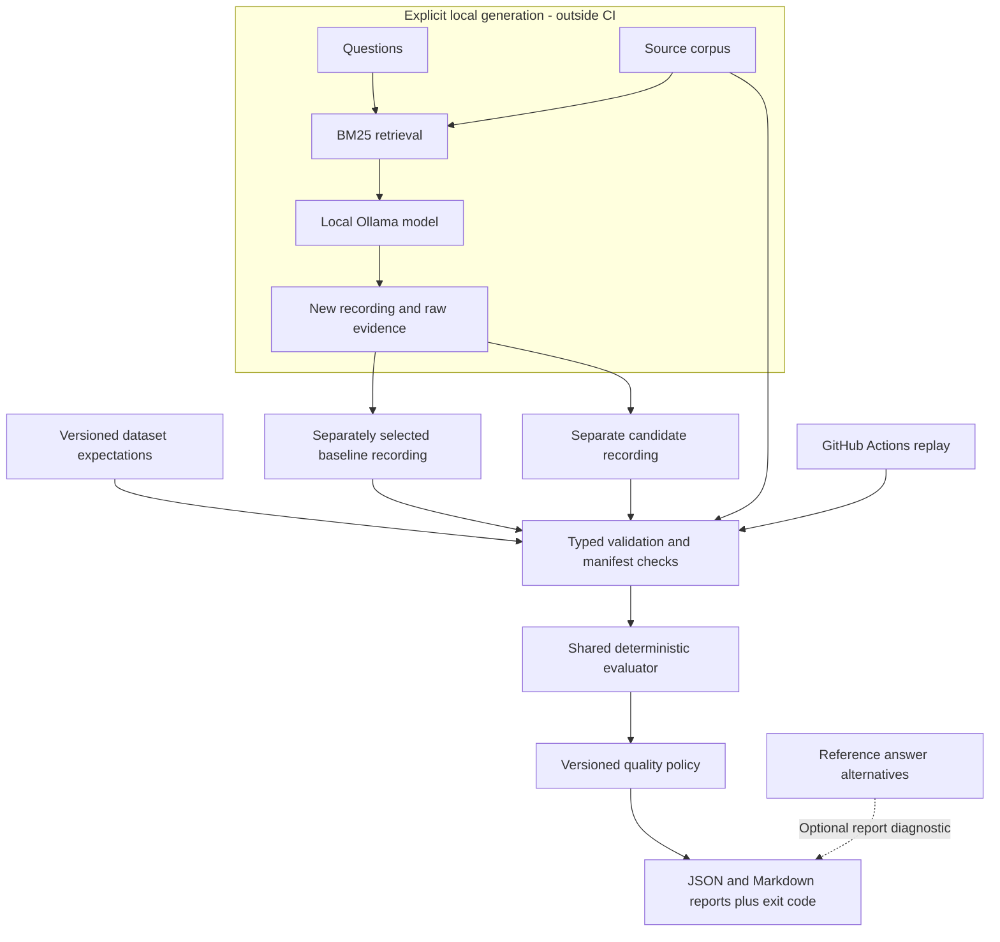

# Regression component architecture

This component compares saved outputs from two RAG configurations. It runs locally
without paid APIs and keeps the accepted reference fixed. The current real reference
is an observed run with known failures, not a release-approved baseline.

The baseline and candidate come from different runs. Selecting a reference is a
deliberate review decision; nothing automatically replaces it. Dataset labels and
reference answers enter evaluation only, never the generation prompt.

## Responsibilities

| Module | Responsibility |
| --- | --- |
| `models.py`, `loading.py` | Typed inputs, unique IDs, exact coverage, compatible dataset versions |
| `provenance.py` | Full-run manifests, configuration consistency, dataset/corpus/evidence hashes |
| `retrieval.py`, `generation.py` | Opt-in local pipeline; question and retrieved passages only |
| `runner.py`, `fact_checks.py`, `source_checks.py` | Apply the same evaluator settings to both recordings |
| `gates.py` | Compare metrics, apply absolute and relative limits, preserve failure evidence |
| `citation_existence.py`, `alternative_diagnostics.py` | Corpus membership and optional answer-variant evidence |
| `reports.py`, `cli.py` | Non-overwriting output and explicit process outcomes |

Required facts use AND semantics. Alternative answer phrases use OR semantics
and remain report-only. V1 gates compare case-weighted phrase coverage,
citation-label coverage, and Recall@K, with an independent critical-case guard.
V2 adds absolute unknown-citation counts and permitted count increases; it requires
corpus evidence even without a diagnostic flag. Both preserve existing checks.

| Report schema | Meaning |
| --- | --- |
| 1 | Historical v1 gate result |
| 2 | Historical v1 diagnostic report |
| 3 | Historical v2 report |
| 4 | Current v1/v2 results, paired case changes, and optional provenance receipt |

## Why keep generation separate?

Replaying fixed outputs is fast, cheap, and repeatable; local generation is slower
and not guaranteed deterministic across runtimes. Raw prompts, outputs, model digest,
generation settings, and file hashes make each recorded run inspectable. No queue,
database, hosted provider, or monitoring stack is needed for this component.
Future runs also capture Git revision/dirty state and generation-package/config
hashes, with a source-drift check around generation. Historical recordings remain
unchanged; missing legacy code snapshots are not evidence of current PR execution.
An [opt-in local wrapper](local-candidate-workflow.md) now connects target capture,
new recording, and freshness-checked comparison. It is tested with mocked generation
and actual local runs and remains separate from the Actions replay workflow.
The [controlled citation fix](../recordings/squad/llama3.2-bm25-citation-enum-v2/README.md)
uses a request-specific enum of retrieved IDs. Parsing still preserves unknown IDs;
the evaluator independently checks corpus membership.

Actions runs tests and known pass/rejection examples without Ollama. A successful
negative test means the detector rejected the expected failure for the right reason.
It does not approve that candidate. Actions does not currently run changed PR
prompts/models to create fresh candidate answers, and it does not deploy anything.

## Evidence and boundaries

The real integration slice contains 25 SQuAD questions and 50 paragraphs. Reducing
the passage budget from three to one changed phrase coverage 0.84 -> 0.68,
citation-label coverage 0.80 -> 0.68, and Recall@3 0.84 -> 0.68. All baseline files
were preserved. See [experiment evidence](../benchmarks/squad-top1-experiment-v1.json).

These checks do not prove general semantic correctness, claim support, or model
generalization. Phrase checks can miss valid unit expressions and accept negation.
Associated-source labels are not exhaustive. Corpus membership establishes only
ID existence in that snapshot. Hashes detect drift, not signed authenticity or
execution of current PR code. Single-run timings are not performance benchmarks.

Hosted Actions execution, artifact upload, and branch-protection enforcement remain
unverified because this repository has not been pushed. Observability and live
traffic monitoring are outside the current scope.

Continue with the [offline demo runbook](demo.md).

## Audit hardening

The recorder reads and hashes dataset/corpus bytes once, parses that snapshot, and
checks source files before completion. Drift leaves partial evidence, never a
completed manifest. Provider errors log fixed categories and sanitized locations;
raw evidence remains separate and must be access-restricted for nonpublic inputs.
Loaders reject duplicate JSON keys and validate labelled source membership when a
corpus is supplied or available beside the dataset. Unknown observed IDs remain
scoreable observations.

Current reports use schema 4; policies and historical artifacts retain their own
versions. Case changes show each metric's delta and flag critical regressions.
A case with gains and losses is classified regressed and lists both. Optional
`max_regressed_cases` counts cases with any of the three metric drops, with the
same 1e-12 tolerance; omission preserves aggregate-only behavior plus the existing
critical-fact guard. No slice-level rule is implemented.

CLI receipts contain input hashes, evaluator package-source hashes, evaluator and
policy versions, and whether an explicit candidate target matched. Relevant inputs
and evaluator source files are checked before/after evaluation; drift prevents
report writing. Pure API callers can provide a receipt; otherwise provenance is
explicitly null. Receipts contain no answers or passages and are not signatures.
Files must not be concurrently rewritten by hostile writers; before/after checks
are not filesystem transactions.
